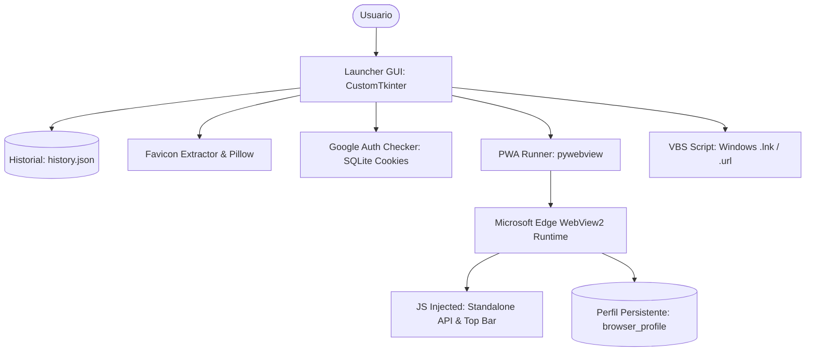

# PROJECT CONTEXT — PWA Simulator

## 1. Información General
- **Nombre del proyecto**: PWA Simulator
- **Objetivo**: Simular, ejecutar e instalar cualquier sitio web o aplicación web moderna como una Progressive Web App (PWA) de escritorio ultra ligera, sin la sobrecarga de memoria de frameworks como Electron, ofreciendo una experiencia fluida con sesiones persistentes de Chromium/Edge WebView2.
- **Tipo de aplicación**: Aplicación de escritorio nativa de Windows (GUI Launcher + Runtime WebView2).
- **Usuarios principales**: Usuarios de ordenador que buscan ligereza, optimización para equipos de recursos moderados/bajos y accesos rápidos directos a servicios web comunes (Discord, Google Workspace, WhatsApp Web, etc.).
- **Estado actual del proyecto**: En desarrollo activo / Versión Portable funcional compilada (v1.0.0).

## 2. Stack Tecnológico
- **Framework de Launcher**: CustomTkinter (>=5.2.0) sobre Tkinter de Python con aceleración de dibujo por canvas.
- **Motor Web / Backend WebView**: `pywebview` (>=5.0) utilizando Microsoft Edge WebView2 (Chromium).
- **Lenguaje**: Python 3.12 (64-bit para Windows).
- **UI & Estilos Frontend / Inyección**: HTML5, CSS3 moderno (Glassmorphism, macOS traffic lights, tema Deep Navy `#0C0E14`), JavaScript Vanilla inyectado para emulación de API PWA.
- **Procesamiento de Imágenes / Favicons**: Pillow (>=10.0.0), BeautifulSoup4 (>=4.12.0), Requests (>=2.31.0).
- **Base de Datos / Almacenamiento**:
  - `history.json` para almacenamiento ligero y desduplicado del historial de navegación y favoritos.
  - Perfil de usuario persistente en `browser_profile/` (Cookies SQLite de Chromium, LocalStorage, IndexedDB).
  - Directorio `URLS/` para almacenamiento de accesos rápidos `.url`.
- **Autenticación**: Detección e integración no invasiva de cuentas Google a través del análisis de cookies de sesión activas en la base SQLite de WebView2.
- **Packaging / Despliegue**: PyInstaller 6.x con spec personalizado (`Windows_Build/PWASimulator.spec`) generando distribución portable en `PWASimulator_Portable/PWASimulator`.

## 3. Arquitectura
La aplicación sigue una arquitectura desacoplada de dos niveles:
1. **Launcher GUI (`gui.py`)**: Interfaz principal frameless desarrollada en CustomTkinter con diseño oscuro, red neuronal decorativa en canvas, controles tipo macOS y gestión de historial/accesos.
2. **PWA Runtime Engine (`pwa_runner.py` / `webview_manager.py`)**: Proceso independiente que levanta ventanas Edge WebView2 con aislamiento de contexto, barra de navegación superior inyectada y emulación de `navigator.standalone` y `display-mode: standalone`.

## 4. Estructura del Proyecto
- `config.py`: Constantes globales, dimensiones de ventana, paleta de colores, rutas de perfiles y user-agents.
- `gui.py`: Ventana principal del lanzador con CustomTkinter, barra frameless con botones macOS, gestión de zoom y animaciones.
- `pwa_runner.py`: Ejecutor de ventanas de simulación PWA con inyección de scripts, emulación de standalone y barra de utilidades.
- `webview_manager.py`: Abstracción y configuración de instancias de Edge WebView2.
- `history.py`: Modelo de datos y persistencia del historial de navegación (`history.json`).
- `google_auth.py`: Utilidad para inspección y validación de sesiones Google en el perfil de Chromium.
- `favicon_extractor.py`: Descarga, extracción y resolución de favicons web en alta resolución.
- `pwa_detector.py`: Análisis de manifests web (`manifest.json`) y etiquetas meta PWA.
- `quick_access.py`: Gestión de accesos directos en disco.
- `Windows_Build/`: Archivos de especificación PyInstaller (`PWASimulator.spec`) e iconos de compilación.
- `PWASimulator_Portable/`: Paquete portable auto-contenido listo para transferir y ejecutar en Windows sin Python instalado.
- `assets/`: Recursos gráficos, iconos SVG/PNG y logo oficial.

## 5. Rutas de la Aplicación
Dado que es una aplicación de escritorio local, las "rutas" corresponden a los flujos y vistas:
- **Vista Launcher Principal**: Entrada de URL, estado de cuenta Google, accesos rápidos y panel de historial reciente.
- **Ventana de Simulación PWA**: Ventana de visualización web dedicada cargando la URL solicitada con barra superior de herramientas.
- **Ventana de Login Google**: Diálogo emergente asistido para inicio/cierre de sesión Google persistente.
- **Menús Contextuales Emergentes**: Diálogos nativos tipo SaaS para 'Ajustes', 'Ventana', 'Vista' y 'Acerca de'.

## 6. Modelo de Datos
### Historial (`HistoryEntry`) en `history.json`:
- `url`: `str` — Dirección URL normalizada del sitio web.
- `title`: `str` — Título extraído de la página o dominio.
- `favicon_path`: `Optional[str]` — Ruta local al archivo de favicon descargado y cacheado.
- `timestamp`: `str` — Marca de tiempo UTC en formato ISO 8601.

### Persistencia de Navegador (`browser_profile/`):
- Estructura estándar de Chromium WebView2 (`EBWebView/Default/Network/Cookies`, Web Data, Local Storage).

## 7. Autenticación y Autorización
- **Sesión de Google**: Gestionada de forma no intrusiva. La app no almacena contraseñas; interactúa con el perfil de Chromium mediante Edge WebView2 para persistir tokens y cookies de autenticación estándar de Google (`SID`, `SSID`, `HSID`, `SAPISID`).
- **Seguridad**: No se almacenan credenciales en texto plano. Todo el almacenamiento de sesión reside en el contenedor seguro provisto por Edge WebView2.

## 8. Funcionalidades
- [IMPLEMENTADO] Lanzador de URLs web con validación y normalización automática (`https://`).
- [IMPLEMENTADO] Detección de manifest PWA y extracción de iconos de alta resolución.
- [IMPLEMENTADO] Barra superior personalizada frameless con 3 botones de control macOS estáticos (Cerrar, Minimizar, Maximizar).
- [IMPLEMENTADO] Sistema de arrastre de ventana fluido y a prueba de cuelgues basado en delta de coordenadas de pantalla.
- [IMPLEMENTADO] Emulación en WebView2 de APIs `display-mode: standalone` y `navigator.standalone`.
- [IMPLEMENTADO] Marco nativo preservado en ventanas secundarias PWA para permitir arrastre, Aero Snap y maximizado en sitios complejos como Discord.
- [IMPLEMENTADO] Generación automática de accesos directos de Windows (.lnk y .url) en el Escritorio.
- [IMPLEMENTADO] Empaquetado portable optimizado y ligero para distribución directa sin instalador.
- [EN PROGRESO] Optimización del caché de favicons y limpieza automática de archivos temporales.
- [PENDIENTE] Soporte para múltiples perfiles de usuario independientes.
- [PENDIENTE] Modo offline asistido con precarga de páginas estáticas.

## 9. Integraciones
- **Microsoft Edge WebView2**: Motor Chromium embebido instalado nativamente en Windows 10/11.
- **Windows Script Host (VBScript / Shell)**: Integración para la creación de accesos directos `.lnk` con iconos dinámicos en el escritorio del usuario.

## 10. Decisiones Técnicas Importantes
- **Decisión**: Uso de CustomTkinter para el Launcher y Edge WebView2 (`pywebview`) para la vista web.
  - **Motivo**: Proporciona el menor consumo de memoria RAM posible (<80MB en reposo) comparado con soluciones Electron (>300MB), haciéndolo ideal para equipos modestos.
- **Decisión**: Eliminación de llamadas Win32 `SendMessageW(WM_NCLBUTTONDOWN)` en favor de arrastre por delta de coordenadas en Tkinter.
  - **Motivo**: Las llamadas reentrantes al bucle modal de mensajes de Windows en el hilo de Tkinter causaban conflictos con `tk86t.dll` cerrando la aplicación inesperadamente.
- **Decisión**: Mantener marco nativo (`frameless=False`) en las ventanas PWA complejas (como Discord).
  - **Motivo**: Sitios con interfaces SPA intensivas capturan eventos de puntero que bloquean el arrastre cuando la ventana es frameless pura.

## 11. Problemas Conocidos
- Al redimensionar pantallas con escalado DPI muy alto (ej. >150%), CustomTkinter puede requerir ajuste manual del nivel de zoom mediante `Ctrl +` / `Ctrl -`.

## 12. Dependencias Importantes
- `customtkinter`: 5.2.x — Framework para la interfaz del lanzador.
- `pywebview`: 5.x — Puente entre Python y Edge WebView2.
- `Pillow`: 10.x — Procesamiento y renderizado LANCZOS de logotipos e iconos.
- `beautifulsoup4` y `requests`: Extracción de metadatos web y favicons.

## 13. Última Actualización
- **Fecha**: 2026-10-07
- **Cambios**: Auditoría técnica y refuerzo arquitectónico: eliminación de superficie RCE en pywebview (migración de js_api a window.expose puntual), sanitización estricta de URLs http/https, normalización de colores HEX, escritura atómica en history.json y URLS/, VBScript parametrizado de forma segura contra inyecciones para .lnk, detección tri-estado no destructiva de Google Auth y desacoplamiento del cierre de sesión de Google (vía endpoint oficial) respecto al perfil global.
